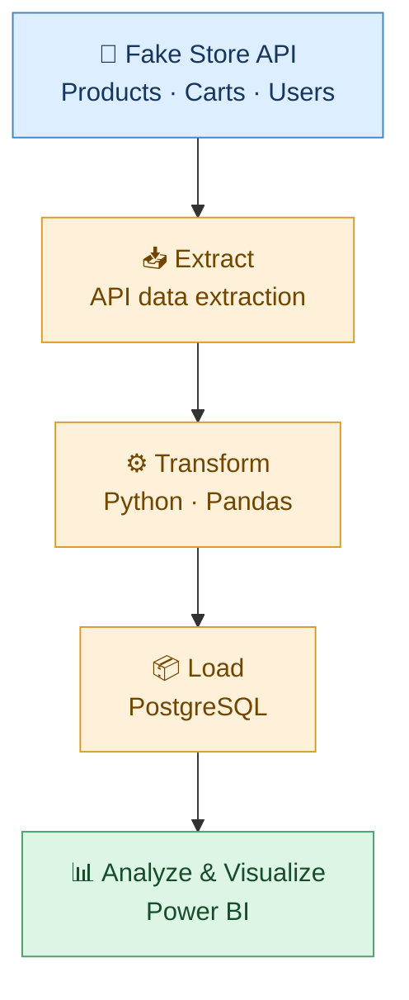
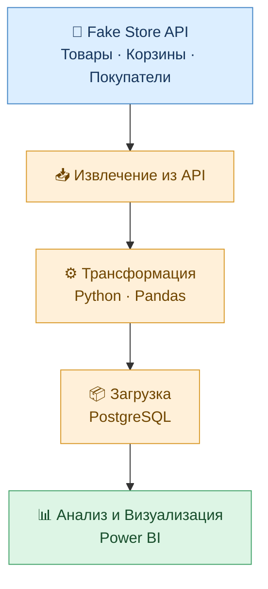
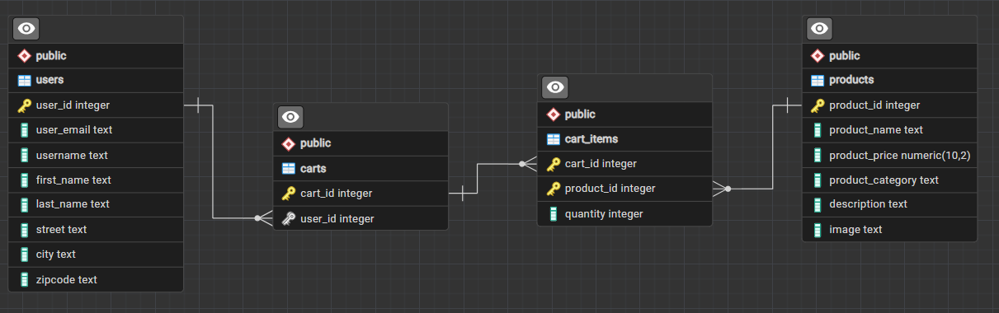

[en English](#english) | [🇷🇺 Русский](#русский)

# ⚙️ETL Pipeline — Fake Store API🛒

ETL project that extracts data from the free public REST API (Fake Store API), transforms it with Python and Pandas, stores it in PostgreSQL, and visualizes insights in Power BI.

## 🔄 ETL Pipeline

## 🛠️ Tech Stack

- 🌐 **Fake Store API** — data source
- 🐍 **Python & Pandas** — data extraction and transformation
- 🐘 **PostgreSQL** — data storage
- 📊 **Power BI** — data visualization
- 🔧 **Git & GitHub** — version control

## 🗄️ Database schema

## 📊 Dashboard Preview

## 🔗 Data Source

- [Fake Store API](https://fakestoreapi.com/)

# ⚙️ETL Пайплайн — Fake Store API🛒

В данном проекте строится ETL пайплайн, который извлекает данные из бесплатного публичного REST API (Fake Store API), трансформирует их в Python, переносит в БД с помощью PostgreSQL и строит аналитический дашборд в Power BI.

## 🔄 Пайплайн

## 🛠️ Стек

- 🌐 **Fake Store API** — Источник данных
- 🐍 **Python & Pandas** — Извлечение днных и трансформация
- 🐘 **PostgreSQL** — Управление БД
- 📊 **Power BI** — Визуализация
- 🔧 **Git & GitHub** — Контроль версий

## 🗄️ Схема базы данных

## 📊 Дашборд

## 🔗 Источник данных

- [Fake Store API](https://fakestoreapi.com/)