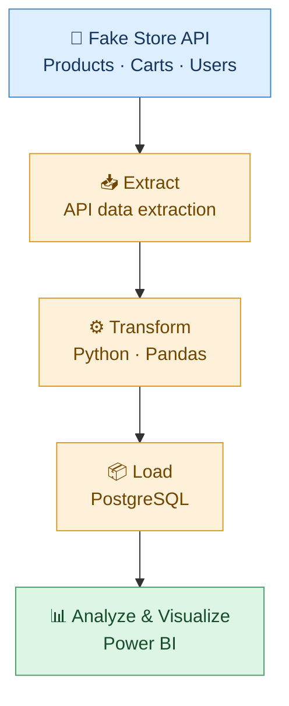

# 🛒 ETL Pipeline — Fake Store API

ETL project that extracts data from the Fake Store API, transforms it with Python and Pandas, stores it in PostgreSQL, and visualizes insights in Power BI.

## 🔄 ETL Pipeline

## 🛠️ Tech Stack

- 🌐 **Fake Store API** — data source
- 🐍 **Python & Pandas** — data extraction and transformation
- 🐘 **PostgreSQL** — data storage
- 📊 **Power BI** — data visualization
- 🔧 **Git & GitHub** — version control

## 📊 Dashboard Preview

## 🔗 Data Source

- [Fake Store API](https://fakestoreapi.com/)

